<p align="center">
  <picture>
    <source media="(prefers-color-scheme: dark)" srcset="docs/brand/openvibes-wordmark-dark.svg">
    
  </picture>
</p>

<h3 align="center">OpenVIBES Protocol</h3>

<p align="center">
  What the <a href="https://github.com/openvibes-project/openvibes-agent">agent</a> and the
  <a href="https://github.com/openvibes-project/openvibes-platform">platform</a> of
  <a href="https://github.com/openvibes-project">OpenVIBES</a> send each other: one spec,
  JSON Schemas, and shared examples that both sides test against.
</p>

## What it is

OpenVIBES is a free, self-hosted security tool: an agent on every host
reports to a platform you run yourself. This repository is the contract
between the two. Both pin it as their `protocol/` submodule and run its
examples in their tests, so any change that crosses the boundary is made
here first.

It covers enrollment and certificate renewal, heartbeats, findings,
inventory, threat alarms, listening services, signed rule bundles and the
export files of agents without a network. Every connection is mutual TLS 1.3.
Rule-signing keys never travel over the protocol, so even a compromised
platform cannot make agents trust new rules.

## What's here

| Path | What |
|---|---|
| [`spec/contracts-v1.md`](spec/contracts-v1.md) | The wire contracts, HTTP API and size limits. The authority. |
| [`schemas/v1/`](schemas/v1) | A JSON Schema for every message. |
| [`fixtures/v1/`](fixtures/v1) | Valid and invalid examples per message. `valid*` must pass, `invalid*` must fail. |
| [`PLAN.md`](PLAN.md) | Every message, its status on each side, and the shared plan. |
| [`docs/overview.md`](docs/overview.md) | All messages in a table, the routes and ports, and what is planned. |

## Check the examples

```sh
python3 -m venv .venv && .venv/bin/pip install --no-deps -r tools/requirements.txt
.venv/bin/python tools/validate.py
```

## Contributing

Contract changes follow [`CONTRIBUTING.md`](CONTRIBUTING.md). Security
problems: please use private vulnerability reporting, not a public issue.

**AI disclosure:** OpenVIBES is built with the help of AI coding tools
(Claude Code and Codex). Every change goes through a pull request and the
full CI before it is merged.

Licensed under the [Apache License 2.0](LICENSE).
